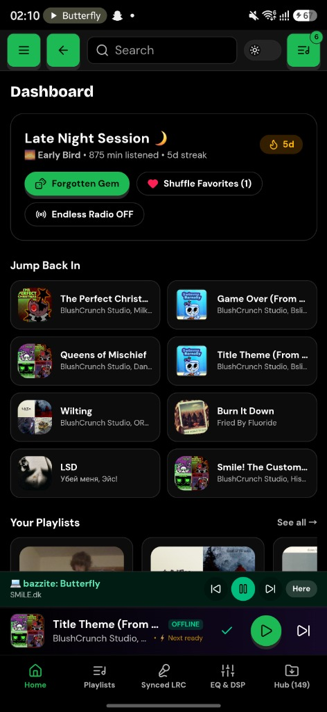
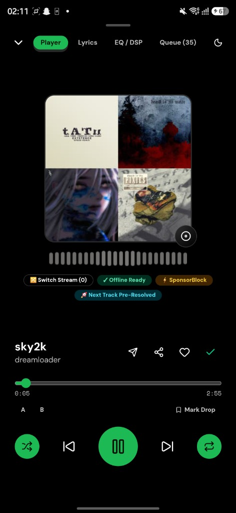
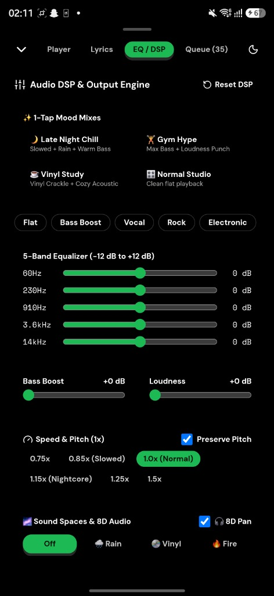
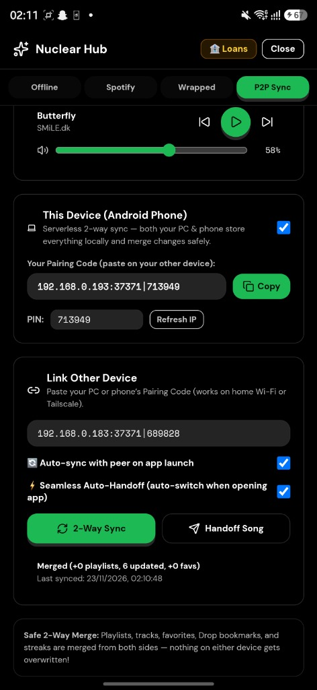
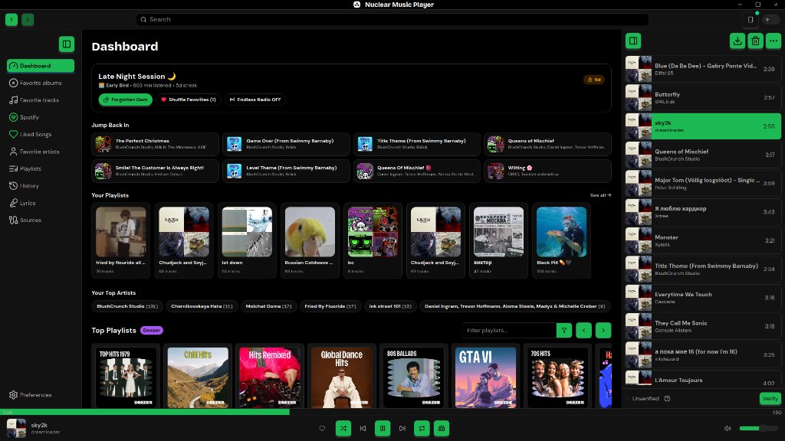
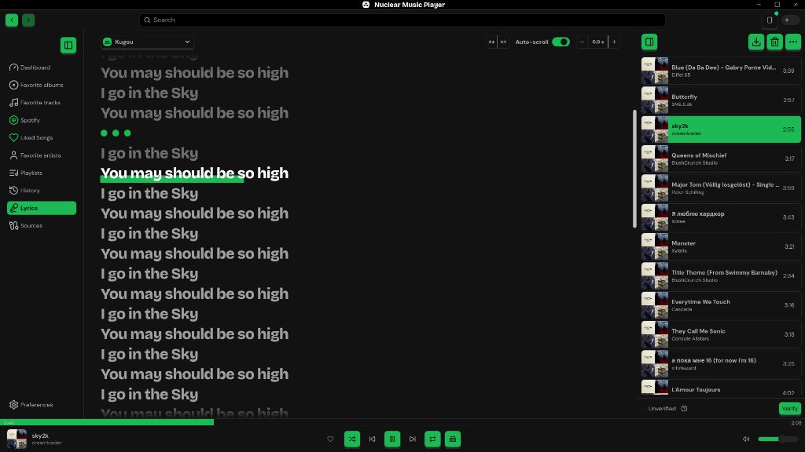
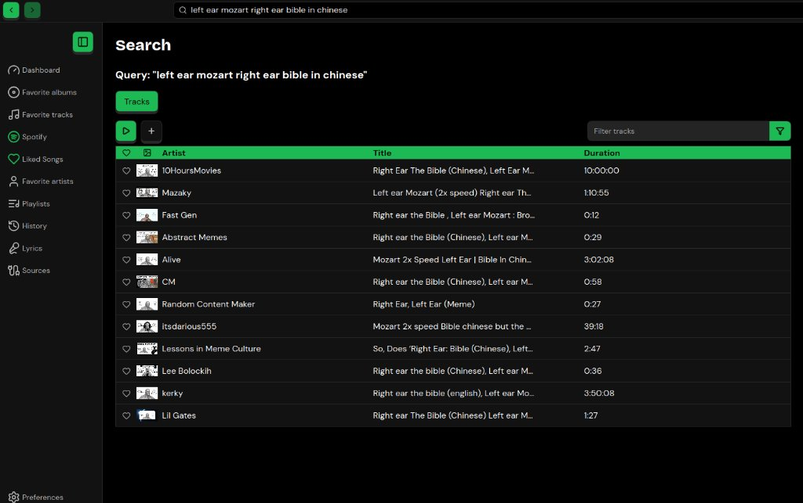
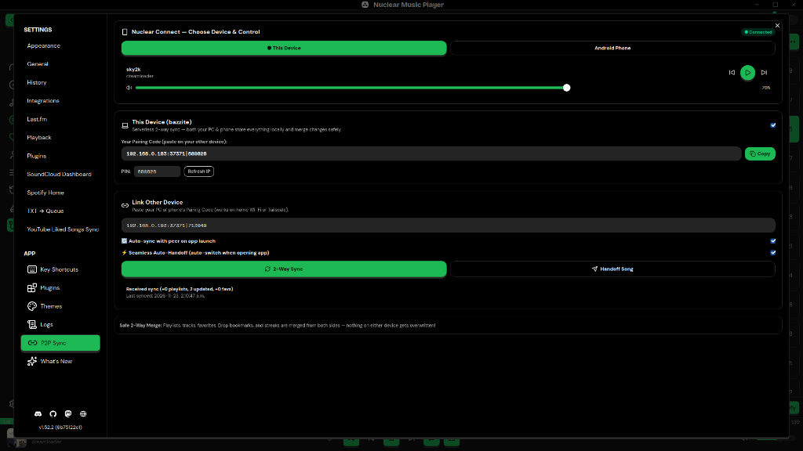

# nuclear-mobile

Android + desktop fork of [Nuclear](https://github.com/nukeop/nuclear) built on Tauri v2.

Upstream Nuclear is desktop-only and relies on spawning a local `yt-dlp` binary, which doesn't work on Android out of the box. This fork replaces the extractor with a native Rust InnerTube/Piped resolver, adds a proper mobile UI shell, Android media session/widget support, WebAudio DSP controls, and local Wi-Fi P2P sync between desktop and phone.

## Downloads

Get the latest packages from the [Releases page](https://github.com/ivan-petrovich1/nuclear-mobile/releases/latest):

- **Android (`arm64`):** `Nuclear-Mobile-Blank-arm64.apk`
- **Linux (`x86_64` & `arm64`, glibc 2.35+):** `.AppImage` (portable), `.deb` (Ubuntu / Debian / Mint / Pop!_OS), `.rpm` (Fedora / openSUSE / Nobara)
- **Windows (`x64`):** `Nuclear-Windows-x64-setup.exe` / `.msi`
- **macOS (`Apple Silicon` & `Intel`):** `Nuclear-macOS-arm64.dmg` (M1–M4) / `Nuclear-macOS-x64.dmg` (Intel). Since builds are ad-hoc signed, if macOS Gatekeeper blocks first launch, run `xattr -cr /Applications/Nuclear.app` in Terminal.

## Screenshots

### Android

| Home | Now Playing | EQ & DSP | P2P Sync |
|:---:|:---:|:---:|:---:|
|  |  |  |  |

### Desktop

| Dashboard | Synced Lyrics |
|:---:|:---:|
|  |  |
| **Search** | **P2P Sync & Remote Control** |
|  |  |

## What's different from upstream

- **Works on Android without `yt-dlp`**: Stream resolution and search run directly in Rust (`ytdlp.rs`) using YouTube InnerTube clients (`VISIONOS`, `IOS`, `TVHTML5_SIMPLY_EMBEDDED_PLAYER`) with Piped API fallback and a local byte-range stream proxy so seeking doesn't break.
- **Native Android integration**: Foreground `MediaSession` service (lock screen, notification shade, Bluetooth controls), home screen widget, shake-to-skip, haptics, and battery optimization prompt.
- **Mobile UI (`MobileAndroidShell`)**: Bottom nav, swipeable mini-player, full-screen Now Playing drawer (Player / Lyrics / DSP / Queue), cover-art color extraction, and true `#000000` OLED dark mode.
- **Audio DSP & effects**: 5-band EQ + presets, bass boost, loudness gain, 8D spatial panner, vocal reduction (karaoke), background soundscapes (rain, vinyl, cafe, campfire), playback speed/pitch, crossfade, silence trimming, and A-B looping.
- **Playback QoL**: SponsorBlock segment skipping, next-track stream pre-resolving, offline track downloads (plus exporting to `Music/Nuclear` on Android), time-synced lyrics via LRCLIB, endless radio, and local listening stats / vibe card export.
- **LAN P2P Sync**: Built-in Axum server (`p2p_sync.rs`, ports `37371-37380`) with 4-digit PIN pairing to merge playlists/favorites/stats over local Wi-Fi or hand off the active queue and timestamp between desktop and phone.

## Building

Requires Node >= 22, pnpm >= 9, and Rust (stable). For Android builds you also need Java 17+ and the Android SDK + NDK (`27.x`).

```bash
git clone https://github.com/ivan-petrovich1/nuclear-mobile.git
cd nuclear-mobile
pnpm install
```

### Desktop

```bash
pnpm dev
```

### Android APK

Make sure the Rust Android targets are installed:

```bash
rustup target add aarch64-linux-android armv7-linux-androideabi i686-linux-android x86_64-linux-android
```

Build the APK:

```bash
pnpm --filter @nuclearplayer/player tauri android build --apk
```

The APK will be generated in:
`packages/player/src-tauri/gen/android/app/build/outputs/apk/universal/release/`

To install on a phone or Waydroid:

```bash
# ADB
adb install -r packages/player/src-tauri/gen/android/app/build/outputs/apk/universal/release/app-universal-release.apk

# Waydroid
waydroid app install packages/player/src-tauri/gen/android/app/build/outputs/apk/universal/release/app-universal-release.apk
```

## License

AGPL-3.0. See [LICENSE](LICENSE).
